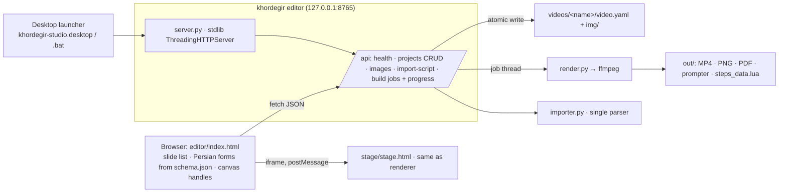

# Architecture

> Current engine below. **Target architecture for the MVP and Phase 2** is at the end of this file. Principles: PRINCIPLES.md.

```mermaid
flowchart LR
  subgraph Authoring
    Y[video.yaml<br/>slides: template + fields + say/layout/steps]
    S[script.txt with markers] -->|khordegir import| Y
    J[layer / chart JSON] -->|file: / spec:| Y
    E[editor/index.html<br/>(stub)] -.save.-> Y
  end
  subgraph Library
    T[templates/&lt;name&gt;/<br/>schema.json + template.js (+css, preview.png)]
    TH[themes/*.js<br/>colors, type, motion, fx]
    IDX[templates/_index.js<br/>auto-generated manifest]
    T --> IDX
  end
  subgraph Stage["stage/ (Chromium page, file://)"]
    C[core.js<br/>Stage.load / seek, API A.*]
    CH[charts.js<br/>bar, hbar, line, counter, compare]
    FX[fx.js<br/>seeded variants, grain, dust, leak, depth, cues]
    L[template-lib.js<br/>header, data parsers]
  end
  Y -->|project.py: normalise, resolve images, number slides, seed| P[payload JSON per slide]
  P -->|render.py: Playwright| C
  IDX --> C
  TH --> C
  C -->|seek i/30 → screenshot| F[frames]
  F -->|ffmpeg libx264 yuv420p CRF18| MP4[slide-NN.mp4]
  C --> PNG[slide-NN.png final frame]
  PNG --> PDF[slides.pdf]
  Y -->|outputs.py| OBS[steps_data.lua · steps.json · prompter.html · prompter.txt]
  C --> CUE[sound_cues.json/txt]
  MP4 & PNG & OBS -->|--copy-to| HS[HarkStudio folder → OBS Lua script plays slide-NN.mp4]
```

## Rendering model
* One HTML stage (`stage/stage.html`, 1920×1080, `dir=rtl`, Vazirmatn woff2) is used by **both** the renderer and the editor preview → preview == output.
* `Stage.load(slide)` builds DOM for the slide's template and fills two **paused** GSAP timelines:
  `Stage.tl` (entrances) and `Stage.amb` (ambient: Ken Burns, glow, dust, grain, leak).
* `Stage.seek(t)` sets both timelines to `t`. The renderer never plays in real time: frame *i* = `seek(i/30)` + screenshot → deterministic.
* Clip length = `max(slide.duration || theme.clip.min (6 s), entrances_end + theme.clip.hold (2.5 s))`. The last 2.5 s have no entrance motion; only image/background ambience continues and OBS freezes on the last frame.
* Randomness is seeded only (`fx.js`, mulberry32 on `"<video-folder>:<slide-no>:<seed>"`).

## Python package (`khordegir/`)
| file | role |
|---|---|
| `cli.py` / `__main__.py` | `build`, `render`, `import`, `new`, `gallery`, `index`, `templates`, `editor` |
| `project.py` | reads `video.yaml`, aliases, slide numbering, steps for OBS, image search paths → `file://` URIs, render layout (SCAM if any step is SCAM) |
| `render.py` | Playwright Chromium, `Stage.load`, per-frame seek+screenshot (JPEG q95 or PNG) → ffmpeg pipe |
| `index.py` | scans template folders (+ `KHORDEGIR_TEMPLATES` env), writes `templates/_index.js`, `themes/_list.js`, per-template hash for incremental builds |
| `outputs.py` | `steps_data.lua`, `steps.json`, `prompter.txt`, `prompter.html` (from `obs/prompter_template.html`), `slides.pdf` |
| `importer.py` | script-with-markers → video.yaml (JS twin: `editor/importer.js`) |
| `gallery.py` | renders each template's `example` → `templates/<n>/preview.png`, `gallery/gallery.png`, `gallery/GALLERY.md` |


## Target architecture (v2, 2026-11-25)



### Contracts
* **Field wrapper:** `A.field(key, el)` returns an outer `[data-field-wrap=key]` element. Overrides `slides[i].overrides.<key> = {x, y, scale}` (px on the 1920×1080 stage, scoped per layout `SLIDE|SCAM`) are applied to the wrapper only; `fx.js` animates the inner node.
* **Schema flags:** `schema.json` fields gain `editable: true` (canvas-movable text/image) vs data-only.
* **Theme tokens:** `themes/<id>.js` exports `{tokens: {bg, surface, text, muted, accent, danger, isDark}, type, motion, fx}`; `theme: random` resolves with the video seed.
* **Reroll:** `slides[i].seed` integer; the editor's «انیمیشن دیگر» increments it.
* **Build jobs:** `POST /api/projects/<n>/build` → `{job}`; `GET /api/jobs/<id>` → `{state, progress 0..1, outputs[]}`.
* **Safety:** server binds 127.0.0.1 only, rejects path traversal, writes YAML via temp file + `os.replace`, returns 400 on invalid YAML without touching the file.
