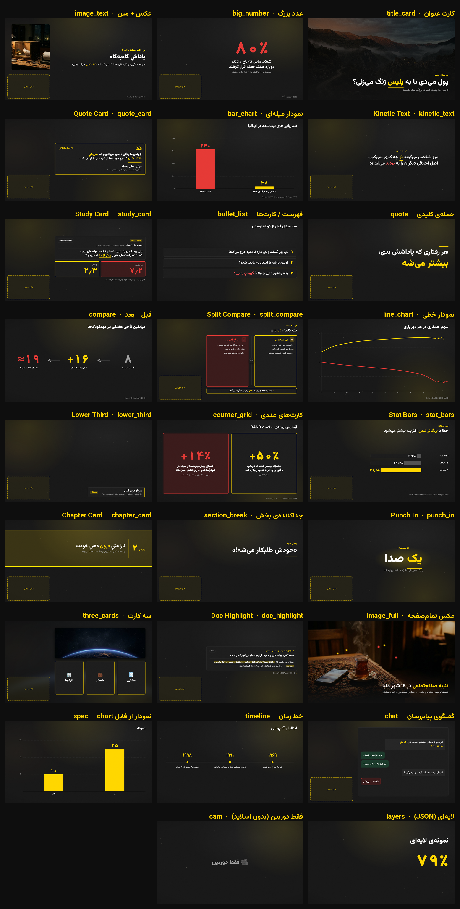

# گالری قالب‌ها

هر قالب: یک تصویر از فریم آخر، اسمی که در `video.yaml` می‌نویسی و فیلدهایش.
قاب زرد خط‌چین در پیش‌نمایش‌ها فقط جای دوربین را نشان می‌دهد (در خروجی نیست).



## کارت عنوان — `template: title_card`

دسته: متن

یک عنوان بزرگ با تیتر کوچک و زیرعنوان؛ می‌تواند روی یک عکس تمام‌صفحه‌ی تیره باشد. برای شروع ویدیو یا شروع هر بخش.


| فیلد | توضیح |
|---|---|
| `eyebrow` | تیتر کوچک بالا |
| `title` | عنوان اصلی (*زرد* ، ~قرمز~) (لازم) |
| `subtitle` | زیرعنوان |
| `image` | عکس پس‌زمینه (اختیاری) |
| `dim` | تیرگی عکس (۰ تا ۱) |
| `align` | جای متن |

نمونه:

```yaml
- template: title_card
  eyebrow: یک سؤال ساده
  title: پول می‌دی یا به *پلیس* زنگ می‌زنی؟
  subtitle: قانونی که پشت همه‌ی باج‌گیری‌ها هست
  layout: SLIDE
```

## عدد بزرگ — `template: big_number`

دسته: عدد

یک عدد خیلی بزرگ که از صفر می‌شمارد (مثل ۸۰٪) با یک جمله زیرش؛ اختیاری با عکس کنارش.


| فیلد | توضیح |
|---|---|
| `number` | عدد (لازم) |
| `prefix` | قبل از عدد (مثل + یا حدود) |
| `suffix` | بعد از عدد (مثل ٪ یا نفر) |
| `from` | شروع شمارش از |
| `color` | رنگ عدد |
| `eyebrow` | تیتر کوچک بالای عدد |
| `caption` | جمله‌ی زیر عدد |
| `detail` | توضیح کوچک |
| `image` | عکس کنار (اختیاری) |
| `motion` | حرکت عکس |

نمونه:

```yaml
- template: big_number
  number: '80'
  suffix: ٪
  color: danger
  caption: شرکت‌هایی که باج دادند، دوباره هدف حمله قرار گرفتند
  detail: نظرسنجی از نزدیک به ۱٬۵۰۰ مدیر امنیت
  source: Cybereason, 2022
  layout: SCAM
```

## عکس + متن — `template: image_text`

دسته: تصویر

یک عکس در قاب گرد (آرام نفس می‌کشد) و کنارش تیتر کوچک، عنوان، متن و چند نکته.


| فیلد | توضیح |
|---|---|
| `image` | عکس (لازم) |
| `eyebrow` | تیتر کوچک (زرد) |
| `title` | عنوان |
| `text` | متن |
| `points` | نکته‌ها / کارت‌ها (هر خط یکی) |
| `motion` | حرکت عکس |
| `fit` | جای‌گیری عکس |
| `shape` | شکل قاب |

نمونه:

```yaml
- template: image_text
  eyebrow: بی. اف. اسکینر، ۱۹۵۷
  title: پاداشِ گاه‌به‌گاه
  text: سرسخت‌ترین رفتار وقتی ساخته می‌شه که *فقط گاهی* جواب بگیره
  source: Ferster & Skinner, 1957
  layout: SCAM
```

## نمودار میله‌ای — `template: bar_chart`

دسته: نمودار

میله‌ها از پایین رشد می‌کنند و عددها روی‌شان می‌شمارند. افقی هم می‌شود (برای برچسب‌های بلند).


| فیلد | توضیح |
|---|---|
| `title` | عنوان |
| `subtitle` | زیرعنوان |
| `data` | داده‌ها |
| `prefix` | قبل از عدد (مثل +) |
| `suffix` | بعد از عدد (مثل ٪) |
| `highlight` | میله‌ی برجسته (برچسب یا شماره) |
| `orientation` | جهت |
| `ymax` | سقف محور (اختیاری) |
| `axis` | محور و خطوط راهنما |

نمونه:

```yaml
- template: bar_chart
  title: آدم‌ربایی‌های ثبت‌شده در ایتالیا
  data:
  - label: ۱۹۶۹ تا ۱۹۹۱
    value: 630
    color: danger
  - label: ۷ سال بعد از قانون ۱۹۹۱
    value: 38
    color: accent
  source: Bohlen / NYT, 1998; Avraham & Porat, 2023
  layout: SLIDE
```

## فهرست / کارت‌ها — `template: bullet_list`

دسته: متن

چند مورد که یکی‌یکی وارد می‌شوند؛ با شماره یا بدون آن، یک یا دو ستون.


| فیلد | توضیح |
|---|---|
| `eyebrow` | تیتر کوچک |
| `title` | عنوان |
| `items` | موردها (هر خط یکی؛ *زرد* ~قرمز~) (لازم) |
| `numbered` | شماره‌دار |
| `columns` | تعداد ستون |

نمونه:

```yaml
- template: bullet_list
  title: سه سؤالِ قبل از کوتاه اومدن
  items:
  - کی زیر فشاره و کی داره از بقیه خرج می‌کنه؟
  - اولین بارشه یا تبدیل به عادت شده؟
  - پناه و اهرم داری یا واقعاً ~گروگانِ بقایی؟~
  layout: SLIDE
```

## نمودار خطی — `template: line_chart`

دسته: نمودار

یک یا چند خط که از چپ به راست کشیده می‌شوند، با برچسب در انتهای هر خط و خط‌چین‌های رویداد.


| فیلد | توضیح |
|---|---|
| `title` | عنوان |
| `subtitle` | زیرعنوان |
| `series` | خط‌ها: «اسم: عدد، عدد، …» هر خط یک سطر |
| `x_labels` | برچسب محور افقی (مثل: ۱=هفته ۱، ۵=هفته ۵) |
| `vlines` | خط‌چین رویداد (مثل: ۵=شروع جریمه) |
| `suffix` | واحد محور عمودی (مثل ٪) |
| `ymax` | سقف محور عمودی |
| `badge` | برچسب کوتاه کنار عنوان (مثل: نمودار مفهومی) |

نمونه:

```yaml
- template: line_chart
  title: سهم همکاری در هر دور بازی
  series: 'با تنبیه: 13.5, 15.5, 16.5, 17.2, 17.6, 17.9, 18.2, 18.4, 18.5, 18.2
  
    بدون تنبیه: 10, 9.4, 8.9, 8.5, 8.1, 7.7, 7.2, 6.5, 5.5, 3.2'
  ymax: 20
  source: Fehr & Gächter, 2000 (AER)
  layout: SLIDE
```

## قبل ← بعد — `template: compare`

دسته: عدد

دو یا سه عدد بزرگ با فلش بینشان (مثل ۸ ← ۱۶ ← ۱۹). از راست به چپ خوانده می‌شود.


| فیلد | توضیح |
|---|---|
| `title` | عنوان |
| `steps` | مرحله‌ها |
| `suffix` | واحد مشترک (مثل ٪) |

نمونه:

```yaml
- template: compare
  title: میانگین تأخیر هفتگی در مهدکودک‌ها
  steps:
  - value: 8
    label: قبل از جریمه
    color: muted
  - value: 16
    prefix: +
    label: با جریمه‌ی ۳ دلاری
    color: accent
  - value: 19
    prefix: ≈
    label: بعد از حذف جریمه
    color: danger
  source: Gneezy & Rustichini, 2000
  layout: SLIDE
```

## کارت‌های عددی — `template: counter_grid`

دسته: عدد

دو تا چهار کارت، هر کدام یک عدد که می‌شمارد و توضیح زیرش (مثل مقایسه‌ی دو گروه).


| فیلد | توضیح |
|---|---|
| `title` | عنوان |
| `cards` | کارت‌ها |

نمونه:

```yaml
- template: counter_grid
  title: آزمایش بیمه‌ی سلامت RAND
  cards:
  - value: 50
    prefix: +
    suffix: ٪
    label: مصرف بیشترِ خدمات درمانی وقتی برای افراد عادی رایگان شد
    sub: خطر اخلاقی
    color: accent
  - value: 14
    prefix: +
    suffix: ٪
    label: احتمال پیش‌بینی‌شده‌ی مرگ در کم‌درآمدهای دارای فشار خون بالا
    sub: وقتی هزینه روی دوششون گذاشتند
    color: danger
  source: Manning et al., 1987; Newhouse, 1993
  layout: SLIDE
```

## جمله‌ی کلیدی — `template: quote`

دسته: متن

یک جمله‌ی بزرگ و پررنگ (با کلمه‌ی زرد/قرمز) و یک خط توضیح کوچک‌تر. برای قانون‌ها و جمع‌بندی‌ها.


| فیلد | توضیح |
|---|---|
| `text` | جمله (*زرد* ، ~قرمز~) (لازم) |
| `highlight` | خط دوم بزرگ‌تر (اختیاری) |
| `highlight_color` | رنگ خط دوم |
| `caption` | توضیح کوچک |
| `author` | گوینده (اختیاری) |

نمونه:

```yaml
- template: quote
  text: هر رفتاری که پاداشش بدی،
  highlight: بیشتر می‌شه
  layout: SCAM
```

## جداکننده‌ی بخش — `template: section_break`

دسته: متن

صفحه‌ی ساده بین دو بخش: شماره/اسم بخش و یک عنوان کوتاه. برای لحظه‌هایی که بیشتر خودت حرف می‌زنی.


| فیلد | توضیح |
|---|---|
| `eyebrow` | بالای عنوان (مثل: بخش ۲) |
| `title` | عنوان (لازم) |
| `subtitle` | زیرعنوان |

نمونه:

```yaml
- template: section_break
  eyebrow: بخش سوم
  title: «خودش طلبکار می‌شه!»
  layout: SCAM
```

## عکس تمام‌صفحه — `template: image_full`

دسته: تصویر

عکس بزرگ با زیرنویس پررنگ؛ در حالت SCAM عکس در قاب بزرگ بالا-راست می‌نشیند تا جای دوربین خالی بماند. می‌شود روی عکس نقطه گذاشت (مثل نقشه).


| فیلد | توضیح |
|---|---|
| `image` | عکس (لازم) |
| `title` | زیرنویس / عنوان (*زرد*) |
| `text` | متن کوچک |
| `dim` | تیرگی عکس (۰ تا ۱) |
| `dots` | نقطه‌ها روی عکس: x,y,رنگ (درصد) هر خط یکی |
| `motion` | حرکت عکس |
| `title_position` | جای عنوان |

نمونه:

```yaml
- template: image_full
  title: '*تنبیه ضداجتماعی* در ۱۶ شهر دنیا'
  text: ضعیف‌تر بودن اعتماد و قانون ← حمله‌ی مفت‌خور به آدمِ درستکار
  dots:
  - 20,40
  - 26,36
  - 48,32,danger
  - 52,30
  - 60,45,danger
  layout: SLIDE
```

## سه کارت — `template: three_cards`

دسته: تصویر

سه (یا دو تا پنج) کارت کنار هم، هر کدام با عکس یا نماد و یک برچسب. اختیاری: یک عکس مشترک بالای کارت‌ها.


| فیلد | توضیح |
|---|---|
| `title` | عنوان |
| `image` | عکس مشترک بالا (اختیاری) |
| `cards` | کارت‌ها |

نمونه:

```yaml
- template: three_cards
  cards:
  - label: مشتری
    icon: 🧾
  - label: همکار
    icon: 💼
  - label: کارفرما
    icon: 🏢
  layout: SCAM
```

## گفتگوی پیام‌رسان — `template: chat`

دسته: ماکت

حباب‌های پیام یکی‌یکی ظاهر می‌شوند. «او» سمت راست (خاکستری)، «من» سمت چپ (سبز تیره)، لحن بد = قرمز.


| فیلد | توضیح |
|---|---|
| `title` | عنوان بالای گفتگو |
| `messages` | پیام‌ها |

نمونه:

```yaml
- template: chat
  messages:
  - from: او
    text: این دو تا بخش جدیدم اضافه کن؛ *کار پنج دقیقه‌ست!*
  - from: من
    text: توی قرارمون نبوده
  - from: من
    text: باز هم نه، زمان می‌بره
  - from: او
    text: ای بابا، روت حساب کرده بودیم رفیق!
  - from: من
    text: باشه... می‌زنم
    tone: bad
  layout: SCAM
```

## خط زمان — `template: timeline`

دسته: نمودار

یک خط افقی که از راست به چپ کشیده می‌شود و نقطه‌های تاریخ با توضیح، یکی‌یکی روی آن ظاهر می‌شوند.


| فیلد | توضیح |
|---|---|
| `title` | عنوان |
| `events` | رویدادها |

نمونه:

```yaml
- template: timeline
  title: ایتالیا و آدم‌ربایی
  events:
  - date: ۱۹۶۹
    text: شروع موج آدم‌ربایی
  - date: ۱۹۹۱
    text: قانون مسدود کردن حساب خانواده
    tone: good
  - date: ۱۹۹۸
    text: فقط ۳۸ مورد در ۷ سال
  layout: SLIDE
```

## نمودار از فایل spec — `template: chart`

دسته: نمودار

نمودار از روی یک فایل JSON (spec) با فیلدهای type/title/data/series؛ برای نمودارهای پیچیده‌تر.


| فیلد | توضیح |
|---|---|
| `spec` | مسیر فایل spec (JSON) |

نمونه:

```yaml
- template: chart
  chart:
    type: bar
    data:
    - label: الف
      value: 10
    - label: ب
      value: 25
      color: accent
  title: نمونه
  layout: SLIDE
```

## لایه‌ای (JSON) — `template: layers`

دسته: ویژه

اسلایدی که از فایل لایه‌ای JSON می‌آید: هر المان با مختصات دقیق. برای طرح‌های خاص.


| فیلد | توضیح |
|---|---|
| `file` | مسیر فایل لایه‌ای JSON |

نمونه:

```yaml
- template: layers
  elements:
  - type: text
    text: نمونه‌ی لایه‌ای
    font: Black
    size: 90
    color: '#FFFFFF'
    x: 1840
    y: 300
    anchor: rs
  - type: counter
    from: 0
    to: 79
    suffix: ٪
    font: Black
    size: 220
    color: '#FFD600'
    x: 1840
    y: 640
    anchor: rs
    delay: 0.2
  layout: SLIDE
```

## فقط دوربین (بدون اسلاید) — `template: cam`

دسته: ویژه

این قدم اسلاید ندارد؛ فقط تصویر خودت تمام‌صفحه. در خروجی OBS به‌صورت CAM ثبت می‌شود و فایل ویدیویی ساخته نمی‌شود.


| فیلد | توضیح |
|---|---|

نمونه:

```yaml
- template: cam
  layout: CAM
```

## فیلدهای مشترک همه‌ی قالب‌ها

| فیلد | توضیح |
|---|---|
| `layout` | SLIDE (اسلاید تمام‌صفحه) / SCAM (اسلاید + من؛ گوشه‌ی پایین-چپ خالی می‌ماند) / CAM (فقط دوربین) |
| `say` | متن تله‌پرامپتر برای این اسلاید |
| `steps` | قدم‌های بیشتر روی همین اسلاید: فهرست `{say, layout, zoom}` |
| `zoom` | زوم OBS با F5: `{x: 0.5, y: 0.5, s: 1.6}` |
| `source` | منبع کوچک پایین-راست (انگلیسی هم می‌شود) |
| `note` | یادداشت کوچک پایین صفحه |
| `duration` | طول کلیپ به ثانیه (پیش‌فرض ۶؛ مثلاً ۲۰ تا عکس بیشتر نفس بکشد) |
| `background` | `{image: bg.jpg, dim: 0.6}` عکس پس‌زمینه‌ی کل صفحه |
| `act` | شماره‌ی پرده (برای OBS) |
